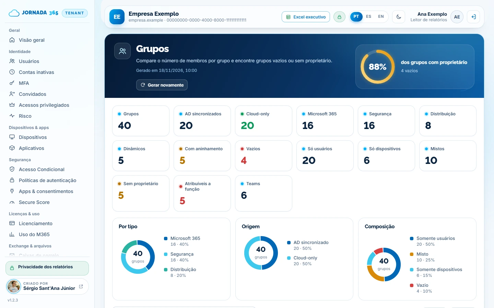

# Tenant Jornada365


O [tenant.jornada365.cloud](https://tenant.jornada365.cloud/) é uma solução **open source** para diagnosticar e administrar recursos do Microsoft 365. O código é distribuído como plugin WordPress sob a licença [GPL-2.0-or-later](LICENSE) e pode ser instalado na hospedagem da própria organização.

O portal reúne relatórios de identidade, segurança, licenças, uso e dispositivos. Operações como sincronização do Intune e arquivamento de caixas de correio usam as permissões delegadas da conta Microsoft. As equipes podem revisar os relatórios no portal e exportar um Excel executivo com gráficos e tabelas.

Criado por Sérgio Sant'Ana Júnior, da Jornada 365. Este repositório é a distribuição pública da linha do portal.

[Baixar o plugin para WordPress](https://github.com/sesantanajr/jornada365-tenant-reports/releases/latest/download/jornada365-tenant-portal.zip) · [Histórico de versões](https://github.com/sesantanajr/jornada365-tenant-reports/releases) · [Como contribuir](CONTRIBUTING.md)

## O que o portal oferece

- **Entra ID e segurança.** Identidade, MFA, contas inativas, convidados, grupos, Acesso Condicional, funções privilegiadas, PIM, risco, aplicativos, consentimentos e Secure Score.
- **Microsoft 365 e Intune.** Licenciamento, inventário e conformidade de dispositivos, versões de aplicativos, uso do Microsoft 365, caixas de correio, OneDrive e SharePoint.
- **Ações delegadas.** Sincronização, reinício e tarefas do Defender em dispositivos elegíveis, operações de arquivo de caixas e ajuste de privacidade de relatórios de uso. A Microsoft aplica as permissões da conta e os requisitos de função e licença de cada operação.
- **Exportação.** Tabelas em CSV e pastas Excel com resumo executivo, gráficos e filtros.



*Relatório de Grupos em uma organização fictícia. Os indicadores e gráficos permitem filtrar os dados exibidos na tabela.*

## Instalação

1. Use WordPress 6.4 ou superior, PHP 8.1 ou superior e HTTPS. A hospedagem precisa permitir as conexões HTTPS de saída necessárias à Microsoft.
2. Baixe o instalador pelo link acima. Em **Plugins → Adicionar plugin → Enviar plugin**, selecione `jornada365-tenant-portal.zip` e ative. Para atualizar uma instalação existente, escolha **Substituir a versão atual pela enviada**. Esse procedimento usa apenas o painel do WordPress.
3. No painel, abra **Tenant Jornada365 → Assistente**. Use a URL de retorno SPA que ele exibir e teste a comunicação com a Microsoft.
4. Abra o portal, selecione **Entrar com Microsoft 365** e, com um administrador autorizado do tenant de teste, selecione **Conectar o tenant**. O assistente orienta o registro do aplicativo e o consentimento delegado no diretório da organização.
5. Valide primeiro um relatório com dados de teste. Teste as ações delegadas com dispositivos ou caixas de laboratório e as funções necessárias.

O aplicativo do portal é registrado em cada tenant. O login usa autorização com PKCE. Configurações de conexão, metadados e auditoria limitada podem ser persistidos no WordPress. Consulte a [análise da versão](docs/analise-da-versao.md) para os detalhes de armazenamento e integração.

## Login corporativo

Em **Tenant Jornada365 → Configurações → Login corporativo**, defina o ID do diretório Microsoft Entra da empresa e, se quiser, personalize o texto do botão. Após salvar, copie o link direto para a intranet ou o site interno. O portal valida o diretório antes de criar a sessão e durante o uso. Consulte o [guia de configuração](docs/login-corporativo.md).

## Relatórios e interface

Se a conexão cair ao iniciar um relatório, o portal pode reencontrar a mesma execução. Durante a leitura, as páginas já recebidas são reaproveitadas pelos relatórios que percorrem coleções grandes. A interface permite acompanhar ou interromper a espera e exportar o resultado em CSV ou Excel. [Correções da versão 1.2.3](docs/versao-1.2.3.md) · [Desempenho e homologação](docs/desempenho.md)

## Desenvolvimento

```bash
find wordpress -name '*.php' -print0 | xargs -0 -r -n 1 php -l
for suite in tests/*.php; do php "$suite" || exit 1; done
for suite in tests/*.cjs; do node "$suite" || exit 1; done
```

Para gerar o instalador a partir do código-fonte, execute `python scripts/package.py` na raiz. O ZIP fica em `dist/`. O guia de contribuição explica como propor uma mudança e reproduzir um problema com dados de teste. Para comunicar uma falha de segurança, consulte a [política de segurança](SECURITY.md).

Código sob [GPL-2.0-or-later](LICENSE). Os avisos MIT dos ícones Fluent e OFL das fontes estão nas pastas de [ícones](wordpress/jornada365-tenant-portal/assets/icons/LICENSE-fluentui-system-icons.txt) e [fontes](wordpress/jornada365-tenant-portal/assets/fonts/OFL-Inter.txt). Marcas identificam seus respectivos titulares.
