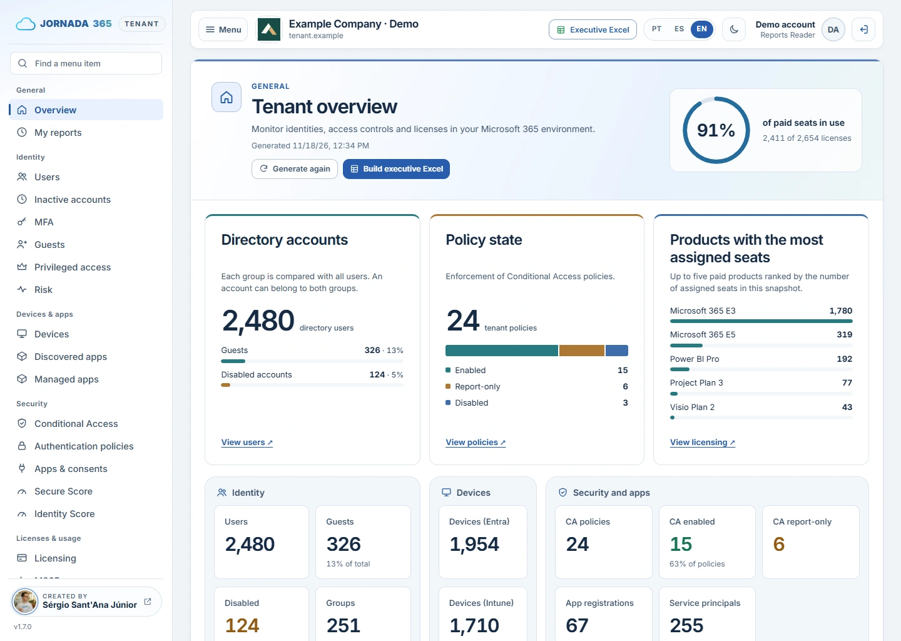
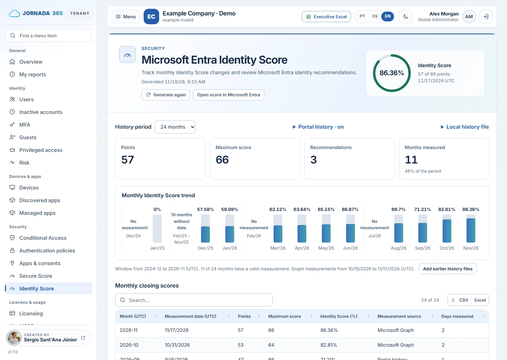
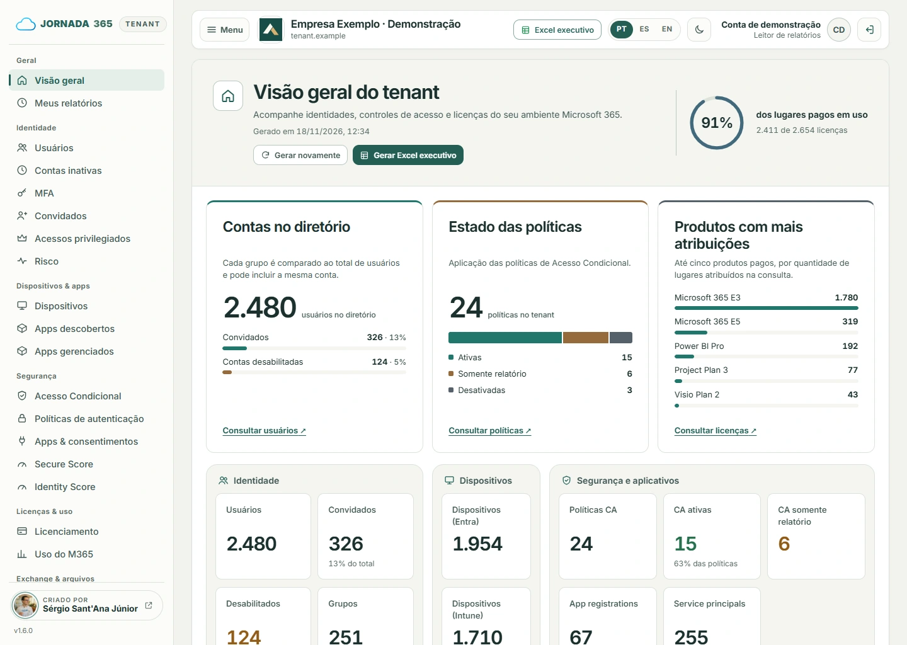
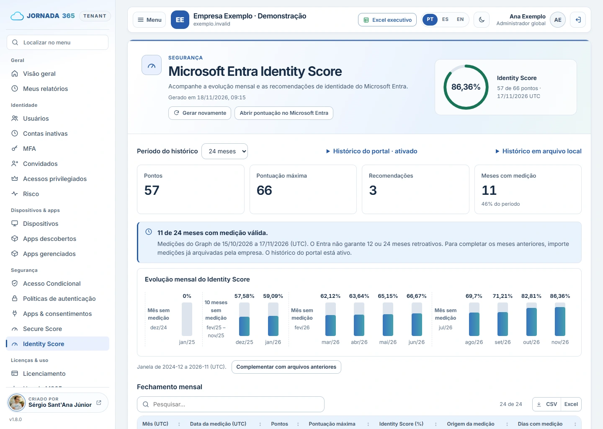

# Jornada 365 Tenant Reports

**The portal is free for everyone at [tenant.jornada365.cloud](https://tenant.jornada365.cloud/).** Use it to review your organization's Microsoft 365 environment. If your company wants its own domain, branding or sign-in experience, you can modify this open-source WordPress plugin and run it on your own hosting, including shared hosting.

[English](#english) · [Português do Brasil](#português-do-brasil) · [Download the WordPress plugin](https://github.com/sesantanajr/jornada365-tenant-reports/releases/latest/download/jornada365-tenant-portal.zip)

## English

### Use the free portal

Open the hosted portal and select **Sign in with Microsoft 365**. On first use, an authorized administrator connects the organization's Microsoft Entra directory and reviews the requested permissions. After setup, people with an allowed role can sign in with their work accounts. Access to individual Microsoft services depends on the organization's licenses and delegated permissions. [Open the portal in English](https://tenant.jornada365.cloud/?lang=en)

### Overview

Compare directory accounts, Conditional Access policy states and the most assigned paid products. Open a chart's report for details, or check the collection times to see which sources responded. The dashboard uses the same Graph requests as the overview it summarizes.

For the logo beside the company name, open **Settings** in the signed-in portal. The organization logo panel shows the image source and lets a tenant administrator configure a fallback. The portal operator's branding is configured separately in WordPress.

### What you can manage

The Users report places account status and directory origin side by side, with an eight-product license ranking below. Select a product to filter the account table and export the matching rows. [Preview the Users report](docs/assets/users-en.webp)

**Device experience.** Open **Devices & apps → Device experience score** for the Intune Endpoint Analytics score (0–100), category scores and comparison baselines. Open the device list to find individual machines with poor scores or insufficient data. [Device experience guide and screenshot](docs/device-experience-score.md)

**Application approval.** Discovered apps show the rule or deployment that supports their approval. Intune catalog matches consider platform, product identity and included required or available assignments. A configurable rule recognizes specific Windows components reported with a Microsoft publisher. On iOS/iPadOS, compare discovered software with catalog entries. Registration type, ownership and collection affect which installations Intune can see. [Approval rules and iOS coverage](docs/discovered-apps.md#english)

| Area | What the portal helps you do |
| --- | --- |
| Identity and security | Review users, guests, inactive accounts, MFA, privileged roles, Conditional Access and Secure Score. |
| Applications and credentials | Inspect OAuth consents and plan secret and certificate renewals. See upcoming expirations in three windows and identify objects with no credential of the same type active beyond 90 days. |
| Microsoft 365 and devices | Review licenses, groups, service usage, mailbox quotas, OneDrive, SharePoint and Intune inventory. |
| My reports | Choose a report, reopen a result in this tab, or resume an interrupted request. An empty queue means there is nothing waiting for your attention. Export a result to keep it after you close or reload the tab. |
| Devices and compliance | Filter by OS release and build. Open a noncompliant device to inspect the policy and settings reported by Intune. |
| Intune app deployments | Inspect required, available and uninstall assignments, included and excluded groups, failure counts and affected devices. Discovered software has its own inventory. |
| Identity Score | Compare the last measured score in each month across 3, 6, 12 or 24 consecutive months. See earned points, available points and the percentage for each observation. |
| Portal audit | Combine date, actor and action filters across the retention period. Load older events to include them in search and exports. |
| Identity Protection | Review risky users and recent detections independently. If Microsoft denies one source, the portal explains its access requirements and shows the other source when available. |
| Delegated operations | Run supported Intune device actions and Exchange mailbox archive operations with the signed-in account's permissions. |
| Excel and CSV | Export a table or build an executive workbook with linked summaries, native Excel charts and filterable data sheets. **Findings and warnings** collects items that need attention, including sections that could not be retrieved. |

**Enabling Identity Score.** Open **Security → Identity Score**, or append `#identityscore` to your portal URL. The menu entry appears even if the module is disabled. To enable it, a WordPress administrator selects **Identity Score (Microsoft Entra)** under **Tenant Jornada365 → Settings → Report modules** and saves. If consent is pending, an authorized tenant administrator can select **Update the app** on a per-tenant installation. On a multi-tenant installation, the operator first updates the app registration in the WordPress setup assistant, then the tenant administrator selects **Approve now**. Readers can copy the appropriate link for their administrator. Once the app has the read-only `DirectoryRecommendations.Read.All` permission, accounts with access can view the score, measurement date and maximum points for that day. [Open Identity Score](https://tenant.jornada365.cloud/?lang=en#identityscore) · [Graph score history](https://learn.microsoft.com/graph/api/recommendation-tenantsecurescores?view=graph-rest-beta)

**Intune permissions.** Enable the Intune compliance details module and approve `DeviceManagementConfiguration.Read.All` to inspect failed policies and settings. App assignments and installation reports use the tenant’s existing Intune permissions. Installation totals come from a Graph beta report. A missing count is displayed as unavailable. [Intune reports and properties](https://learn.microsoft.com/intune/device-management/reports/ref-graph-available-reports)

*Groups report in English. The Brazilian Portuguese screenshot below uses the same 40 fictional groups.*

Identity Score opens on 24 months and groups consecutive missing months on the chart. **Coverage by source** shows the first and last valid measurements and how many closings each source supplied. In **Security → Identity Score → Portal history**, a tenant administrator can opt in to retain the latest measured score for each of 24 UTC calendar months. Generating the report collects available Graph observations. Months without a measurement remain empty. The Excel export identifies each source. Select **Add earlier history files** to combine existing archives. Operators using an authorized multi-tenant app can offer daily WP-Cron collection with a separate tenant opt-in. [History, access, erasure and unattended collection](docs/identity-score-history.md#english)

In **Overview**, select **Build executive Excel** to choose the sections for your workbook. The example includes credential renewals, OAuth consents, identity recommendations and a monthly Identity Score chart. [Download the example workbook in English](docs/examples/tenant-review-en.xlsx?raw=true)

### Host and customize it for your company

1. Use WordPress 6.4 or newer, PHP 8.1 or newer, HTTPS and outbound connectivity to Microsoft. Download the installable ZIP from Releases. [WordPress installer](https://github.com/sesantanajr/jornada365-tenant-reports/releases/latest/download/jornada365-tenant-portal.zip)
2. In **Plugins → Add Plugin → Upload Plugin**, upload the ZIP and activate it. For an upgrade, choose **Replace current with uploaded**. Installation works from the WordPress dashboard on shared hosting.
3. Create a WordPress page for the portal and select it in **Tenant Jornada365 → Configurações → Página do portal**. You can also place the shortcode `[j365_tenant_portal]` on a page. In the setup assistant (**Assistente**), verify the HTTPS sign-in callback for your domain.
4. In **Configurações**, set your company name, logo, support contact, policy links and enabled modules. For a single-company login, enter the Microsoft Entra directory ID under **Login corporativo**, customize the button and copy the sign-in link for your intranet.
5. Open your new portal and connect the directory with an authorized administrator. Use the exact SPA redirect URI shown by your installation when configuring the app registration.

**Data handling.** WordPress stores portal settings, tenant bindings and a pseudonymized audit trail. A tenant can also retain its fallback logo and opt in to a 24-month archive of aggregate Identity Score measurements. During generation, it temporarily stores encrypted report state. Collecting the completed result removes the job. Abandoned jobs are cleaned up periodically. The browser builds the final workbook. Credential reports use identifiers and validity dates.

The installer is built from `wordpress/jornada365-tenant-portal/`. To build it locally, run `python scripts/package.py` from the repository root. The ZIP is written to `dist/`. Created by Sérgio Sant'Ana Júnior, Jornada 365. [GPL-2.0-or-later](LICENSE) · [Contributing](CONTRIBUTING.md) · [Security](SECURITY.md) · [Releases](https://github.com/sesantanajr/jornada365-tenant-reports/releases)

The bundled Fluent icons have an MIT notice, and the fonts have SIL Open Font License notices. [Icon credits](wordpress/jornada365-tenant-portal/assets/icons/LICENSE-fluentui-system-icons.txt) · [Font notices](wordpress/jornada365-tenant-portal/assets/fonts)

## Português do Brasil

**O portal está disponível gratuitamente para todos em [tenant.jornada365.cloud](https://tenant.jornada365.cloud/).** Use o serviço para analisar o Microsoft 365 da sua organização. Se a empresa precisar de domínio, identidade visual ou login próprios, pode modificar este plugin WordPress de código aberto e implantá-lo na hospedagem da empresa, inclusive em hospedagem compartilhada.

### Usar o portal gratuito

Abra o portal e selecione **Entrar com Microsoft 365**. No primeiro acesso, um administrador autorizado conecta o diretório Microsoft Entra da empresa e revisa as permissões solicitadas. Depois, as pessoas com uma função aceita pelo portal entram com a conta corporativa. O acesso a cada serviço Microsoft depende das licenças e permissões delegadas da organização. [Abrir o portal em português](https://tenant.jornada365.cloud/?lang=pt-BR)

### Visão geral

Compare as contas do diretório, o estado das políticas de Acesso Condicional e os produtos pagos com mais atribuições. Abra o relatório pelo gráfico para investigar ou consulte os horários de coleta para saber quais fontes responderam.

Para verificar a imagem ao lado do nome da empresa, entre no portal e abra **Configurações → Logotipo da organização**. O painel mostra a origem da marca e permite que um administrador do tenant configure uma imagem alternativa. A marca do operador do portal é configurada no WordPress.

### O que você pode gerenciar

Em **Usuários**, compare a situação e a origem das contas. No ranking abaixo, selecione uma licença para filtrar a tabela e exportar os usuários correspondentes. [Ver a tela de Usuários](docs/assets/users-pt-br.webp)

**Experiência dos dispositivos.** Abra **Dispositivos & apps → Score dos dispositivos** para consultar a pontuação do Intune Endpoint Analytics (0–100), as categorias e as referências de comparação. Abra a lista de dispositivos para identificar máquinas com pontuação baixa ou dados insuficientes. [Guia e captura em português](docs/device-experience-score.md#português-do-brasil)

**Homologação de aplicativos.** Em **Apps descobertos**, consulte o critério de cada aplicativo. A correspondência com o catálogo considera plataforma, identidade do produto e atribuição de instalação obrigatória ou disponível com um público incluído. Uma regra configurável reconhece componentes específicos do Windows com editor Microsoft. Em iOS/iPadOS, compare o catálogo ao inventário detectado. A modalidade de inscrição, a propriedade e a coleta influenciam quais instalações o Intune consegue identificar. [Critérios de homologação e cobertura do iOS](docs/discovered-apps.md#português)

| Área | O que o portal permite fazer |
| --- | --- |
| Identidade e segurança | Revisar usuários, convidados, contas inativas, MFA, funções privilegiadas, Acesso Condicional e Secure Score. |
| Aplicativos e credenciais | Revisar consentimentos OAuth e planejar a renovação de segredos e certificados. Identifique vencimentos em três faixas e objetos sem outra credencial do mesmo tipo ativa além de 90 dias. |
| Microsoft 365 e dispositivos | Analisar licenças, grupos, uso dos serviços, cotas de caixas de correio, OneDrive, SharePoint e inventário do Intune. |
| Meus relatórios | Escolher um relatório, reabrir um resultado nesta aba ou retomar uma consulta interrompida. A fila vazia indica que não há consultas pendentes. Exporte o resultado para mantê-lo depois de recarregar ou fechar a aba. |
| Dispositivos e conformidade | Filtrar por versão e build do sistema. Abra um dispositivo não conforme para consultar a política e as configurações reportadas pelo Intune. |
| Implantação de aplicativos do Intune | Consultar instalações obrigatórias, opcionais e desinstalações, grupos incluídos e excluídos, totais de falhas e dispositivos afetados. O software descoberto tem um inventário próprio. |
| Identity Score | Comparar a última medição de cada mês em períodos de 3, 6, 12 ou 24 meses consecutivos. Consultar os pontos obtidos, o máximo e o percentual de cada medição. |
| Auditoria do portal | Combinar filtros de data, ator e ação durante o período de retenção. Carregue eventos anteriores para incluí-los na pesquisa e na exportação. |
| Identity Protection | Consultar usuários em risco e detecções recentes de forma independente. Se a Microsoft recusar uma das fontes, o portal explica os requisitos e mostra os dados disponíveis da outra. |
| Operações delegadas | Executar ações suportadas em dispositivos do Intune e gerenciar o arquivamento de caixas no Exchange com as permissões da conta conectada. |
| Excel e CSV | Exportar uma tabela ou montar uma pasta de trabalho com resumos interligados, gráficos nativos do Excel e abas filtráveis. **Observações e avisos** reúne os itens que merecem atenção, inclusive as seções que falharam na coleta. |

**Como habilitar o Identity Score.** Abra **Segurança → Identity Score** ou acrescente `#identityscore` à URL do seu portal. A opção aparece mesmo quando o módulo está desativado. Para habilitá-lo, um administrador do WordPress marca **Identity Score (Microsoft Entra)** em **Tenant Jornada365 → Configurações → Módulos de relatório** e salva. Se houver consentimento pendente, um administrador autorizado do tenant pode selecionar **Atualizar o aplicativo** em uma instalação por tenant. Em uma instalação multitenant, o operador primeiro atualiza o registro do aplicativo no Assistente do WordPress e depois o administrador do tenant seleciona **Aprovar agora**. Quem tem acesso de leitura pode copiar o link para o administrador responsável. Com a permissão de leitura `DirectoryRecommendations.Read.All` aprovada, contas autorizadas podem consultar a pontuação, a data da medição e os pontos máximos daquele dia. [Abrir Identity Score](https://tenant.jornada365.cloud/?lang=pt-BR#identityscore) · [Histórico de pontuação no Graph](https://learn.microsoft.com/graph/api/recommendation-tenantsecurescores?view=graph-rest-beta)

**Permissões do Intune.** Habilite **Detalhes de conformidade do Intune** e aprove `DeviceManagementConfiguration.Read.All` para consultar as políticas e configurações com falha. As atribuições e os relatórios de instalação usam as permissões de Intune já solicitadas pelo portal. O total de falhas vem de um relatório do Graph beta. Quando o Intune omite uma contagem, o portal a marca como indisponível. [Relatórios e propriedades do Intune](https://learn.microsoft.com/intune/device-management/reports/ref-graph-available-reports)

*Relatório de Grupos em português brasileiro. São os mesmos 40 grupos fictícios da captura em inglês.*

O Identity Score abre em 24 meses e agrupa os meses consecutivos sem dados no gráfico. **Cobertura por origem** identifica a primeira e a última medição válida e quantos fechamentos cada fonte forneceu. Em **Segurança → Identity Score → Histórico do portal**, um administrador do tenant pode autorizar a retenção da última medição de cada mês em uma janela de 24 meses UTC. O portal consulta o Graph ao gerar o relatório. Os meses sem medição ficam em branco e o Excel identifica a origem de cada fechamento. Selecione **Complementar com arquivos anteriores** para reunir históricos existentes. Empresas que usam o aplicativo multitenant autorizado podem habilitar a coleta diária pelo WP-Cron por meio de uma autorização separada. [Histórico, acesso, exclusão e coleta agendada](docs/identity-score-history.md#português)

Em **Visão geral**, selecione **Gerar Excel executivo** e escolha as seções da planilha. O exemplo inclui renovações de credenciais, consentimentos OAuth, recomendações de identidade e um gráfico mensal do Identity Score. [Baixar a planilha de exemplo em português](docs/examples/tenant-review-pt-br.xlsx?raw=true)

### Hospedar e personalizar para sua empresa

1. Use WordPress 6.4 ou superior, PHP 8.1 ou superior, HTTPS e acesso de saída aos serviços Microsoft. Baixe o ZIP instalável na página de lançamentos. [Instalador para WordPress](https://github.com/sesantanajr/jornada365-tenant-reports/releases/latest/download/jornada365-tenant-portal.zip)
2. No WordPress, abra **Plugins → Adicionar plugin → Enviar plugin**, envie o ZIP e ative. Para atualizar, selecione **Substituir a versão atual pela enviada**. O procedimento funciona pelo painel em hospedagem compartilhada.
3. Crie uma página no WordPress e selecione-a em **Tenant Jornada365 → Configurações → Página do portal**. Também é possível inserir o shortcode `[j365_tenant_portal]` em uma página. Em **Assistente**, confira o endereço HTTPS de retorno do login no seu domínio.
4. Em **Configurações**, defina nome, logo, contato de suporte, links das políticas e módulos habilitados. Para usar um login exclusivo da empresa, informe o ID do diretório Microsoft Entra em **Login corporativo**, personalize o botão e copie o link para a intranet. [Guia do login corporativo](docs/login-corporativo.md)
5. Abra o portal da empresa e conecte o diretório com um administrador autorizado. Ao configurar o registro de aplicativo, use exatamente o endereço de retorno SPA mostrado na sua instalação.

**Uso dos dados.** O WordPress guarda as configurações do portal, os vínculos dos tenants e a auditoria pseudonimizada. Cada empresa pode guardar uma imagem alternativa e ativar um histórico agregado de até 24 meses do Identity Score. Durante a geração, o progresso do relatório fica temporariamente cifrado. A coleta do resultado remove o trabalho concluído. Uma rotina periódica limpa os trabalhos abandonados. O navegador gera a planilha final. Os relatórios de credenciais usam identificadores e datas de validade. [Desempenho e implantação](docs/desempenho.md)

O instalador é gerado a partir de `wordpress/jornada365-tenant-portal/`. Para compilá-lo localmente, execute `python scripts/package.py` na raiz do repositório. O ZIP fica em `dist/`. Projeto criado por Sérgio Sant'Ana Júnior, da Jornada 365. [GPL-2.0-or-later](LICENSE) · [Contribuições](CONTRIBUTING.md) · [Segurança](SECURITY.md) · [Lançamentos](https://github.com/sesantanajr/jornada365-tenant-reports/releases)

Os ícones Fluent incluem o aviso da licença MIT e as fontes incluem os avisos da SIL Open Font License. [Créditos dos ícones](wordpress/jornada365-tenant-portal/assets/icons/LICENSE-fluentui-system-icons.txt) · [Licenças das fontes](wordpress/jornada365-tenant-portal/assets/fonts)
