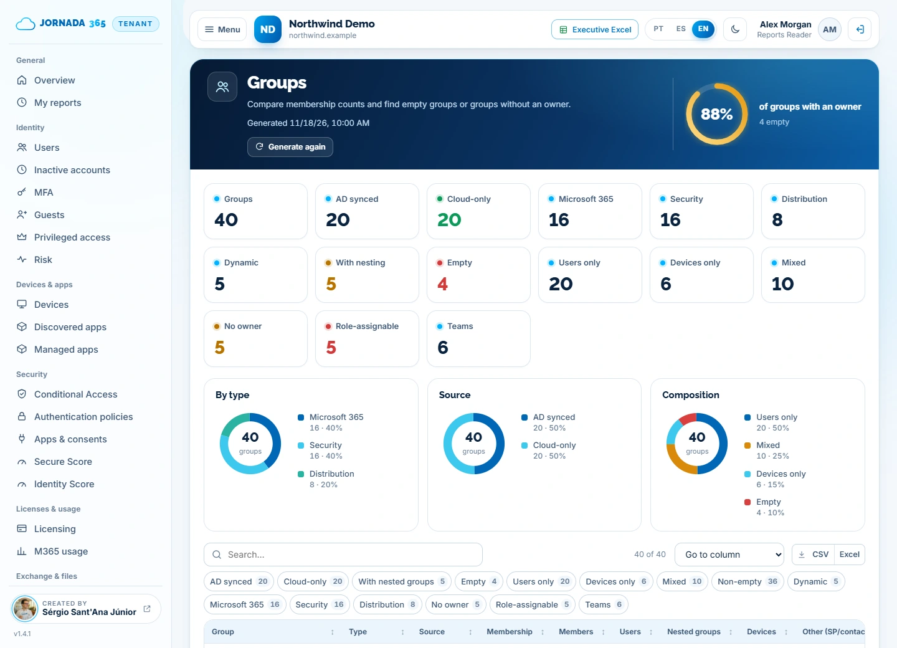
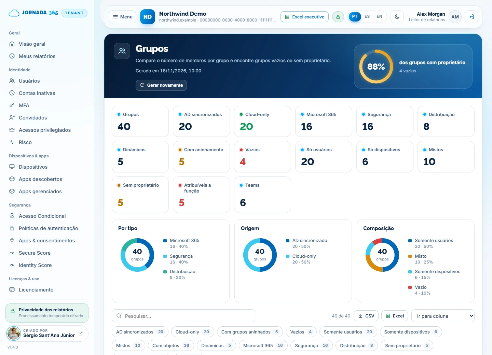

# Jornada 365 Tenant Reports

**The portal is free for everyone at [tenant.jornada365.cloud](https://tenant.jornada365.cloud/).** Use it to review your organization's Microsoft 365 environment. If your company wants its own domain, branding or sign-in experience, you can modify this open-source WordPress plugin and run it on your own hosting, including shared hosting.

[English](#english) · [Português do Brasil](#português-do-brasil) · [Download the WordPress plugin](https://github.com/sesantanajr/jornada365-tenant-reports/releases/latest/download/jornada365-tenant-portal.zip)

## English

### Use the free portal

Open the hosted portal and select **Sign in with Microsoft 365**. On first use, an authorized administrator connects the organization's Microsoft Entra directory and reviews the requested permissions. After setup, people with an allowed role can sign in with their work accounts. Access to individual Microsoft services depends on the organization's licenses and delegated permissions. [Open the portal in English](https://tenant.jornada365.cloud/?lang=en)

### What you can manage

| Area | What the portal helps you do |
| --- | --- |
| Identity and security | Review users, guests, inactive accounts, MFA, privileged roles, Conditional Access and Secure Score. |
| Applications and credentials | Inspect OAuth consents and plan secret and certificate renewals. See upcoming expirations in three windows and identify objects with no credential of the same type active beyond 90 days. |
| Microsoft 365 and devices | Review licenses, groups, service usage, mailbox quotas, OneDrive, SharePoint and Intune inventory. |
| My reports | Resume a pending query, open a result already delivered to this tab, or discard a report job from your own session. |
| Devices and compliance | Filter by OS release and build. Open a noncompliant device to inspect the policy and settings reported by Intune. |
| Intune app deployments | Inspect required, available and uninstall assignments, included and excluded groups, failure counts and affected devices. Discovered software has its own inventory. |
| Identity Score | Review the dated Entra identity score, available points and individual recommendations. |
| Portal audit | Combine date, actor and action filters across the retention period. Load older events to include them in search and exports. |
| Delegated operations | Run supported Intune device actions and Exchange mailbox archive operations with the signed-in account's permissions. |
| Excel and CSV | Export a table or build an executive workbook with linked summaries, native Excel charts and filterable data sheets. **Findings and warnings** collects items that need attention, including sections that could not be retrieved. |

**Upgrading to 1.4.** Review the enabled modules in **Tenant Jornada365 → Settings**. The **Identity Score (Microsoft Entra)** module uses the read-only `DirectoryRecommendations.Read.All` permission. After enabling it, a tenant administrator should update the app consent. The report uses Graph beta and shows the measurement date and maximum points Entra recorded on that day. [Graph score history](https://learn.microsoft.com/graph/api/recommendation-tenantsecurescores?view=graph-rest-beta)

**Intune permissions.** Enable the Intune compliance details module and approve `DeviceManagementConfiguration.Read.All` to inspect failed policies and settings. App assignments and installation reports use the tenant’s existing Intune permissions. Installation totals come from a Graph beta report. A missing count is displayed as unavailable. [Intune reports and properties](https://learn.microsoft.com/intune/device-management/reports/ref-graph-available-reports)

*Groups report in English. The Brazilian Portuguese screenshot below uses the same 40 fictional groups.*

In **Overview**, select **Build executive Excel** to choose the sections for your workbook. The example includes credential renewals, OAuth consents, identity recommendations and a dated Identity Score chart. A day with no reading stays blank in the workbook. [Download the example workbook in English](docs/examples/tenant-review-en.xlsx?raw=true)

### Host and customize it for your company

1. Use WordPress 6.4 or newer, PHP 8.1 or newer, HTTPS and outbound connectivity to Microsoft. Download the installable ZIP from Releases. [WordPress installer](https://github.com/sesantanajr/jornada365-tenant-reports/releases/latest/download/jornada365-tenant-portal.zip)
2. In **Plugins → Add Plugin → Upload Plugin**, upload the ZIP and activate it. For an upgrade, choose **Replace current with uploaded**. Installation works from the WordPress dashboard on shared hosting.
3. Create a WordPress page for the portal and select it in **Tenant Jornada365 → Configurações → Página do portal**. You can also place the shortcode `[j365_tenant_portal]` on a page. In the setup assistant (**Assistente**), verify the HTTPS sign-in callback for your domain.
4. In **Configurações**, set your company name, logo, support contact, policy links and enabled modules. For a single-company login, enter the Microsoft Entra directory ID under **Login corporativo**, customize the button and copy the sign-in link for your intranet.
5. Open your new portal and connect the directory with an authorized administrator. Use the exact SPA redirect URI shown by your installation when configuring the app registration.

**Data handling.** WordPress stores portal settings, tenant bindings and a pseudonymized audit trail. During generation, it temporarily stores encrypted report state. Collecting the completed result removes the job. Abandoned jobs are cleaned up periodically. The browser builds the final workbook. Credential reports use identifiers and validity dates.

The installer is built from `wordpress/jornada365-tenant-portal/`. To build it locally, run `python scripts/package.py` from the repository root. The ZIP is written to `dist/`. Created by Sérgio Sant'Ana Júnior, Jornada 365. [GPL-2.0-or-later](LICENSE) · [Contributing](CONTRIBUTING.md) · [Security](SECURITY.md) · [Releases](https://github.com/sesantanajr/jornada365-tenant-reports/releases)

The bundled Fluent icons have an MIT notice, and the fonts have SIL Open Font License notices. [Icon credits](wordpress/jornada365-tenant-portal/assets/icons/LICENSE-fluentui-system-icons.txt) · [Font notices](wordpress/jornada365-tenant-portal/assets/fonts)

## Português do Brasil

**O portal está disponível gratuitamente para todos em [tenant.jornada365.cloud](https://tenant.jornada365.cloud/).** Use o serviço para analisar o Microsoft 365 da sua organização. Se a empresa precisar de domínio, identidade visual ou login próprios, pode modificar este plugin WordPress de código aberto e implantá-lo na hospedagem da empresa, inclusive em hospedagem compartilhada.

### Usar o portal gratuito

Abra o portal e selecione **Entrar com Microsoft 365**. No primeiro acesso, um administrador autorizado conecta o diretório Microsoft Entra da empresa e revisa as permissões solicitadas. Depois, as pessoas com uma função aceita pelo portal entram com a conta corporativa. O acesso a cada serviço Microsoft depende das licenças e permissões delegadas da organização. [Abrir o portal em português](https://tenant.jornada365.cloud/?lang=pt-BR)

### O que você pode gerenciar

| Área | O que o portal permite fazer |
| --- | --- |
| Identidade e segurança | Revisar usuários, convidados, contas inativas, MFA, funções privilegiadas, Acesso Condicional e Secure Score. |
| Aplicativos e credenciais | Revisar consentimentos OAuth e planejar a renovação de segredos e certificados. Identifique vencimentos em três faixas e objetos sem outra credencial do mesmo tipo ativa além de 90 dias. |
| Microsoft 365 e dispositivos | Analisar licenças, grupos, uso dos serviços, cotas de caixas de correio, OneDrive, SharePoint e inventário do Intune. |
| Meus relatórios | Retomar uma consulta pendente, abrir um resultado já entregue à aba ou descartar um trabalho de relatório da própria sessão. |
| Dispositivos e conformidade | Filtrar por versão e build do sistema. Abra um dispositivo não conforme para consultar a política e as configurações reportadas pelo Intune. |
| Implantação de aplicativos do Intune | Consultar instalações obrigatórias, opcionais e desinstalações, grupos incluídos e excluídos, totais de falhas e dispositivos afetados. O software descoberto tem um inventário próprio. |
| Identity Score | Consultar a pontuação de identidade do Entra por data, os pontos disponíveis e as recomendações individuais. |
| Auditoria do portal | Combinar filtros de data, ator e ação durante o período de retenção. Carregue eventos anteriores para incluí-los na pesquisa e na exportação. |
| Operações delegadas | Executar ações suportadas em dispositivos do Intune e gerenciar o arquivamento de caixas no Exchange com as permissões da conta conectada. |
| Excel e CSV | Exportar uma tabela ou montar uma pasta de trabalho com resumos interligados, gráficos nativos do Excel e abas filtráveis. **Observações e avisos** reúne os itens que merecem atenção, inclusive as seções que falharam na coleta. |

**Ao atualizar para a versão 1.4.** Em **Tenant Jornada365 → Configurações**, confira os módulos habilitados. O módulo **Identity Score (Microsoft Entra)** usa a permissão de leitura `DirectoryRecommendations.Read.All`. Depois de habilitá-lo, um administrador do tenant deve atualizar o consentimento do aplicativo. A pontuação e o histórico vêm do Graph beta. A tela exibe a data da medição e os pontos máximos registrados pelo Entra naquele dia. [Histórico de pontuação no Graph](https://learn.microsoft.com/graph/api/recommendation-tenantsecurescores?view=graph-rest-beta)

**Permissões do Intune.** Habilite **Detalhes de conformidade do Intune** e aprove `DeviceManagementConfiguration.Read.All` para consultar as políticas e configurações com falha. As atribuições e os relatórios de instalação usam as permissões de Intune já solicitadas pelo portal. O total de falhas vem de um relatório do Graph beta. Quando o Intune omite uma contagem, o portal a marca como indisponível. [Relatórios e propriedades do Intune](https://learn.microsoft.com/intune/device-management/reports/ref-graph-available-reports)

*Relatório de Grupos em português brasileiro. São os mesmos 40 grupos fictícios da captura em inglês.*

Em **Visão geral**, selecione **Gerar Excel executivo** e escolha as seções da planilha. O exemplo inclui renovações de credenciais, consentimentos OAuth, recomendações de identidade e um gráfico do Identity Score por data. Um dia sem medição permanece em branco na planilha. [Baixar a planilha de exemplo em português](docs/examples/tenant-review-pt-br.xlsx?raw=true)

### Hospedar e personalizar para sua empresa

1. Use WordPress 6.4 ou superior, PHP 8.1 ou superior, HTTPS e acesso de saída aos serviços Microsoft. Baixe o ZIP instalável na página de lançamentos. [Instalador para WordPress](https://github.com/sesantanajr/jornada365-tenant-reports/releases/latest/download/jornada365-tenant-portal.zip)
2. No WordPress, abra **Plugins → Adicionar plugin → Enviar plugin**, envie o ZIP e ative. Para atualizar, selecione **Substituir a versão atual pela enviada**. O procedimento funciona pelo painel em hospedagem compartilhada.
3. Crie uma página no WordPress e selecione-a em **Tenant Jornada365 → Configurações → Página do portal**. Também é possível inserir o shortcode `[j365_tenant_portal]` em uma página. Em **Assistente**, confira o endereço HTTPS de retorno do login no seu domínio.
4. Em **Configurações**, defina nome, logo, contato de suporte, links das políticas e módulos habilitados. Para usar um login exclusivo da empresa, informe o ID do diretório Microsoft Entra em **Login corporativo**, personalize o botão e copie o link para a intranet. [Guia do login corporativo](docs/login-corporativo.md)
5. Abra o portal da empresa e conecte o diretório com um administrador autorizado. Ao configurar o registro de aplicativo, use exatamente o endereço de retorno SPA mostrado na sua instalação.

**Uso dos dados.** O WordPress guarda as configurações do portal, os vínculos dos tenants e a auditoria pseudonimizada. Durante a geração, o progresso do relatório fica temporariamente cifrado. A coleta do resultado remove o trabalho concluído. Uma rotina periódica limpa os trabalhos abandonados. O navegador gera a planilha final. Os relatórios de credenciais usam identificadores e datas de validade. [Desempenho e implantação](docs/desempenho.md)

O instalador é gerado a partir de `wordpress/jornada365-tenant-portal/`. Para compilá-lo localmente, execute `python scripts/package.py` na raiz do repositório. O ZIP fica em `dist/`. Projeto criado por Sérgio Sant'Ana Júnior, da Jornada 365. [GPL-2.0-or-later](LICENSE) · [Contribuições](CONTRIBUTING.md) · [Segurança](SECURITY.md) · [Lançamentos](https://github.com/sesantanajr/jornada365-tenant-reports/releases)

Os ícones Fluent incluem o aviso da licença MIT e as fontes incluem os avisos da SIL Open Font License. [Créditos dos ícones](wordpress/jornada365-tenant-portal/assets/icons/LICENSE-fluentui-system-icons.txt) · [Licenças das fontes](wordpress/jornada365-tenant-portal/assets/fonts)
