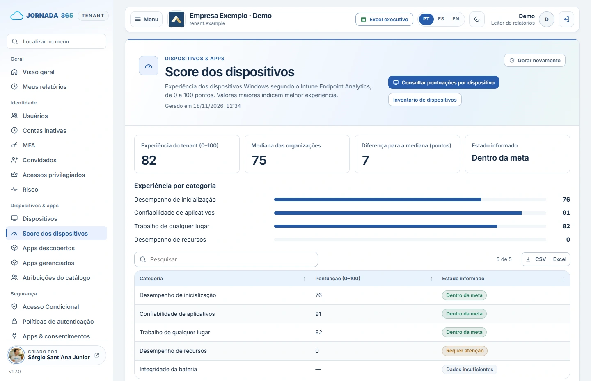

# Device experience score

## English

Open **Devices & apps → Device experience score** to see how Intune rates the Windows endpoint experience on a scale of 0–100. The overview shows the tenant score, the categories Intune measured and available comparison baselines. The difference is expressed in points. [Microsoft's guide to scores and baselines](https://learn.microsoft.com/intune/endpoint-analytics/scores)

Open the device scores to inspect individual machines, filter by health and export the filtered list. Devices can have insufficient data for a measurement. In Excel, an unavailable score has an empty cell and a measured zero has a numeric zero.

The report uses the Microsoft Graph v1.0 read permission `DeviceManagementManagedDevices.Read.All`. Device eligibility, Intune licensing, data collection and the signed-in account's roles affect coverage. [Intune prerequisites](https://learn.microsoft.com/intune/endpoint-analytics/index) · [Configure Endpoint Analytics](https://learn.microsoft.com/intune/endpoint-analytics/configure)

### When Intune cannot return the overview

Microsoft documents the tenant overview as a singleton at `GET /v1.0/deviceManagement/userExperienceAnalyticsOverview`. The response contains an ID. The URL ends at `Overview`. If this request returns a resource-not-found code with HTTP 400, or returns HTTP 404, the portal checks baselines and the documented score history collection. It selects the newest dated record with a valid score across the pages received. The displayed date belongs to that measurement. If a later page fails, the report marks history as partial. If Intune only returns comparison baselines, the portal shows those baselines on their own. [Overview contract](https://learn.microsoft.com/graph/api/intune-devices-userexperienceanalyticsoverview-get?view=graph-rest-1.0) · [Score history](https://learn.microsoft.com/graph/api/intune-devices-userexperienceanalyticsscorehistory-list?view=graph-rest-1.0) · [v1.0 production metadata](https://github.com/microsoftgraph/msgraph-metadata/blob/master/schemas/v1.0-Prod.csdl)

| What you see | What to check |
| --- | --- |
| Resource unavailable or no historical measurement | In the Intune admin center, open **Reports → Endpoint analytics → Overview**. Verify enrollment and data collection policy assignment for eligible Windows devices. Allow processing after a restart. [Enrollment and collection](https://learn.microsoft.com/intune/endpoint-analytics/configure) |
| Insufficient data | A meaningful score requires at least five reporting devices. Open the per-device list to inspect the available records. [Score requirements](https://learn.microsoft.com/intune/endpoint-analytics/scores) |
| Permission missing or HTTP 403 | Verify that the application in the connected organization has consent for `DeviceManagementManagedDevices.Read.All`. For delegated access, check the operator’s role and device scope. An Intune custom role needs **Endpoint Analytics/Read**, **Organization/Read** and **Managed Devices/Read**. A generic 403 gives no single root cause. [Roles and prerequisites](https://learn.microsoft.com/intune/endpoint-analytics/index) |
| Licensing restriction reported by Microsoft | Confirm an active Intune license. The resource performance and battery health reports are Advanced Analytics features. [Advanced Analytics](https://learn.microsoft.com/intune/advanced-analytics/) |

## Português do Brasil

Em **Dispositivos & apps → Score dos dispositivos**, o portal exibe a experiência Windows medida pelo **Microsoft Intune Endpoint Analytics**. A pontuação oficial do tenant e as categorias variam de 0 a 100 pontos. Valores maiores indicam melhor experiência. A conformidade com políticas é consultada separadamente em **Dispositivos**. [Como a Microsoft calcula e compara pontuações](https://learn.microsoft.com/intune/endpoint-analytics/scores)

O resumo mostra as categorias que o Intune retornou. A mediana é a referência interna identificada por `isBuiltIn`. Referências personalizadas aparecem na mesma tabela. A diferença corresponde ao score atual do tenant menos a pontuação da referência, em pontos. A data das referências personalizadas indica a criação daquela referência. [Resumo do tenant](https://learn.microsoft.com/graph/api/intune-devices-userexperienceanalyticsoverview-get?view=graph-rest-1.0) · [Referências do Intune](https://learn.microsoft.com/graph/api/intune-devices-userexperienceanalyticsbaseline-list?view=graph-rest-1.0)

Use **Consultar pontuações por dispositivo** para buscar nome, fabricante, modelo, estado e pontuações de experiência, inicialização, aplicativos, trabalho remoto e bateria. A lista carrega sob demanda, é paginada e pode ter cobertura diferente do inventário. A seleção deste relatório no Excel executivo inclui a lista de dispositivos. As pontuações e diferenças são células numéricas. [Pontuações por dispositivo](https://learn.microsoft.com/graph/api/intune-devices-userexperienceanalyticsdevicescores-list?view=graph-rest-1.0)

### Acesso e cobertura

As consultas usam o Microsoft Graph v1.0 e a permissão de leitura `DeviceManagementManagedDevices.Read.All`, já usada pelo inventário. Ela se aplica ao modelo delegado e ao de aplicativo. No modelo delegado, a Microsoft documenta o papel **Reports Reader** do Entra e **Read Only Operator** do Intune, entre outras funções. O tenant precisa de uma licença Intune ativa, dispositivos Windows elegíveis e coleta do Endpoint Analytics configurada. A Microsoft exige pelo menos cinco dispositivos reportando para uma pontuação significativa. [Pré-requisitos e funções](https://learn.microsoft.com/intune/endpoint-analytics/index) · [Configurar a coleta](https://learn.microsoft.com/intune/endpoint-analytics/configure)

Um traço indica uma pontuação ausente, fora da escala ou acompanhada por um estado desconhecido ou de dados insuficientes. Um zero retornado com estado avaliável continua sendo zero. Uma resposta parcial conserva os registros já recebidos e identifica a seção afetada. Em caso de HTTP 403, confira consentimento, funções e acesso ao Intune com o administrador.

Os relatórios de desempenho de recursos e integridade da bateria fazem parte do Intune Advanced Analytics. A disponibilidade dessas categorias depende dos recursos habilitados e dos dados dos dispositivos. [Intune Advanced Analytics](https://learn.microsoft.com/intune/advanced-analytics/)

### Quando o Intune não encontra o resumo

O caminho oficial é `GET /v1.0/deviceManagement/userExperienceAnalyticsOverview`. Nos metadados de produção do Microsoft Graph, a propriedade aponta para um único `userExperienceAnalyticsOverview`. O ID é um campo do objeto retornado. As referências, as pontuações por dispositivo e o histórico são coleções. [Contrato do resumo](https://learn.microsoft.com/graph/api/intune-devices-userexperienceanalyticsoverview-get?view=graph-rest-1.0) · [Metadados de produção v1.0](https://github.com/microsoftgraph/msgraph-metadata/blob/master/schemas/v1.0-Prod.csdl)

Se o Intune responder HTTP 400 com código de recurso não encontrado, ou HTTP 404, o portal continua a consulta das referências e busca `userExperienceAnalyticsScoreHistory`. Entre as páginas recebidas, escolhe a medição válida de data mais recente e mostra a pontuação e suas categorias com aquela data. Se houver interrupção da paginação, o painel identifica a cobertura parcial. Quando apenas referências estão disponíveis, o portal as mostra com seus nomes. A mediana das organizações e a média dos dispositivos não substituem o valor do tenant. [Coleção de histórico](https://learn.microsoft.com/graph/api/intune-devices-userexperienceanalyticsscorehistory-list?view=graph-rest-1.0)

| O que aparece | O que conferir |
| --- | --- |
| Recurso não encontrado ou histórico vazio | No Intune, abra **Relatórios → Endpoint Analytics → Visão geral**, confirme o registro e a atribuição da política de coleta a equipamentos Windows elegíveis. Os dados podem levar até 24 horas após uma reinicialização para aparecer. [Configurar a coleta](https://learn.microsoft.com/intune/endpoint-analytics/configure) |
| Dados insuficientes | A Microsoft requer pelo menos cinco dispositivos reportando para um score significativo. **Consultar pontuações por dispositivo** permite verificar quais equipamentos aparecem. [Cobertura de pontuações](https://learn.microsoft.com/intune/endpoint-analytics/scores) |
| Permissão ausente ou HTTP 403 | Confira o consentimento do aplicativo para `DeviceManagementManagedDevices.Read.All`. No acesso delegado, verifique a função e o escopo do operador para os dispositivos. Funções personalizadas do Intune precisam de **Endpoint Analytics/Read**, **Organization/Read** e **Managed Devices/Read**. O código 403 isolado não identifica qual requisito falhou. [Funções e pré-requisitos](https://learn.microsoft.com/intune/endpoint-analytics/index) |
| A Microsoft informa restrição de licença | Confira a licença ativa de Intune e a disponibilidade do Advanced Analytics para bateria e desempenho de recursos. [Advanced Analytics](https://learn.microsoft.com/intune/advanced-analytics/) |
