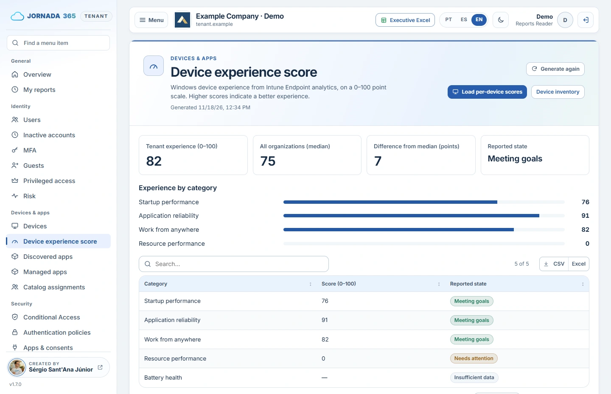

# Device experience score

## English

Open **Devices & apps → Device experience score** to see how Intune rates the Windows endpoint experience on a scale of 0–100. The overview shows the tenant score, the categories Intune measured and available comparison baselines. The difference is expressed in points. [Microsoft's guide to scores and baselines](https://learn.microsoft.com/intune/endpoint-analytics/scores)

Open the device scores to inspect individual machines, filter by health and export the filtered list. Devices can have insufficient data for a measurement. In Excel, an unavailable score has an empty cell and a measured zero has a numeric zero.

The report uses the Microsoft Graph read permission `DeviceManagementManagedDevices.Read.All`. Device eligibility, Intune licensing, data collection and the signed-in account's roles affect coverage. [Intune prerequisites](https://learn.microsoft.com/intune/endpoint-analytics/index) · [Configure Endpoint Analytics](https://learn.microsoft.com/intune/endpoint-analytics/configure)

### When Intune cannot return the overview

The Graph examples for the overview, a single baseline and a category put the object inside `value`. The portal reads that form and a direct object. It treats a `value` array as a collection. [Overview response](https://learn.microsoft.com/graph/api/intune-devices-userexperienceanalyticsoverview-get?view=graph-rest-1.0) · [Baseline response](https://learn.microsoft.com/graph/api/intune-devices-userexperienceanalyticsbaseline-get?view=graph-rest-1.0) · [Category response](https://learn.microsoft.com/graph/api/intune-devices-userexperienceanalyticscategory-get?view=graph-rest-1.0)

The portal first reads the v1.0 overview. If the singleton is missing (HTTP 404 or a recognized resource-not-found code with HTTP 400), or the response lacks score and health fields, it tries the documented beta overview with the same permission. A v1.0 access denial keeps its own diagnosis. If neither version supplies the overview, the portal looks for the newest valid dated score in the v1.0 history. An incomplete history is identified. When those sources yield no measurement, the portal can read the current app reliability category separately. That category never supplies an overall score. [Stable overview](https://learn.microsoft.com/graph/api/intune-devices-userexperienceanalyticsoverview-get?view=graph-rest-1.0) · [Beta overview](https://learn.microsoft.com/graph/api/intune-devices-userexperienceanalyticsoverview-get?view=graph-rest-beta) · [Score history](https://learn.microsoft.com/graph/api/intune-devices-userexperienceanalyticsscorehistory-list?view=graph-rest-1.0) · [App health category](https://learn.microsoft.com/graph/api/intune-devices-userexperienceanalyticscategory-get?view=graph-rest-1.0)

To compare with the Intune admin center, select **All Devices** in the same organization and use the same comparison baseline. Device scope filters the devices measured. A named baseline is a snapshot used for comparison. The portal reads the default tenant overview and does not inherit your browser’s Intune selection. Microsoft documents neither `baselineName` nor `deviceScope` as parameters of this overview. The beta scope-summary function reports scope counts and processing state. An Intune-connected fleet can report even when the Configuration Manager data source is disconnected. [Device scopes](https://learn.microsoft.com/intune/advanced-analytics/device-scopes) · [Scope summary](https://learn.microsoft.com/graph/api/resources/intune-devices-userexperienceanalyticsdevicescopesummary?view=graph-rest-beta) · [Collection sources](https://learn.microsoft.com/intune/endpoint-analytics/configure)

**Category comparison** shows the current measurement, the saved baseline and the difference in points. You can filter by baseline name and export the displayed rows. The baseline query expands five documented category relationships. If the service rejects the expansion, the portal requests the basic list. When it receives a single custom baseline without an overall score, it reads that baseline by ID and retrieves missing categories in one batch. With multiple baselines, **Load categories** opens one baseline on demand. Missing measurements and historical tenant scores leave current comparisons blank. [Baseline relationships](https://learn.microsoft.com/graph/api/resources/intune-devices-userexperienceanalyticsbaseline?view=graph-rest-1.0) · [Get a baseline](https://learn.microsoft.com/graph/api/intune-devices-userexperienceanalyticsbaseline-get?view=graph-rest-1.0)

| What you see | What to check |
| --- | --- |
| Resource unavailable or no historical measurement | Compare **Reports → Endpoint analytics → Overview** for **All Devices**. If scores are present, record the Graph route, status and code shown in the portal. If Intune is empty too, check enrollment and the collection policy for eligible devices. [Enrollment and collection](https://learn.microsoft.com/intune/endpoint-analytics/configure) |
| Insufficient data | A meaningful score requires at least five reporting devices. Open the per-device list to inspect the available records. [Score requirements](https://learn.microsoft.com/intune/endpoint-analytics/scores) |
| Permission missing or HTTP 403 | Verify that the application in the connected organization has consent for `DeviceManagementManagedDevices.Read.All`. For delegated access, check the operator’s role and device scope. An Intune custom role needs **Endpoint Analytics/Read**, **Organization/Read** and **Managed Devices/Read**. A generic 403 gives no single root cause. [Roles and prerequisites](https://learn.microsoft.com/intune/endpoint-analytics/index) |
| Licensing restriction reported by Microsoft | Confirm an active Intune license. The resource performance and battery health reports are Advanced Analytics features. [Advanced Analytics](https://learn.microsoft.com/intune/advanced-analytics/) |

## Português do Brasil

Em **Dispositivos & apps → Score dos dispositivos**, o portal exibe a experiência Windows medida pelo **Microsoft Intune Endpoint Analytics**. A pontuação oficial do tenant e as categorias variam de 0 a 100 pontos. Valores maiores indicam melhor experiência. A conformidade com políticas é consultada separadamente em **Dispositivos**. [Como a Microsoft calcula e compara pontuações](https://learn.microsoft.com/intune/endpoint-analytics/scores)

O resumo mostra as categorias que o Intune retornou. A mediana é a referência interna identificada por `isBuiltIn`. Referências personalizadas aparecem na mesma tabela. A diferença corresponde ao score atual do tenant menos a pontuação da referência, em pontos. A data das referências personalizadas indica a criação daquela referência. [Resumo do tenant](https://learn.microsoft.com/graph/api/intune-devices-userexperienceanalyticsoverview-get?view=graph-rest-1.0) · [Referências do Intune](https://learn.microsoft.com/graph/api/intune-devices-userexperienceanalyticsbaseline-list?view=graph-rest-1.0)

Use **Consultar pontuações por dispositivo** para buscar nome, fabricante, modelo, estado e pontuações de experiência, inicialização, aplicativos, trabalho remoto e bateria. A lista carrega sob demanda, é paginada e pode ter cobertura diferente do inventário. A seleção deste relatório no Excel executivo inclui a lista de dispositivos. As pontuações e diferenças são células numéricas. [Pontuações por dispositivo](https://learn.microsoft.com/graph/api/intune-devices-userexperienceanalyticsdevicescores-list?view=graph-rest-1.0)

### Acesso e cobertura

As consultas usam a permissão de leitura do Microsoft Graph `DeviceManagementManagedDevices.Read.All`, já usada pelo inventário. Ela se aplica ao modelo delegado e ao de aplicativo. No modelo delegado, a Microsoft documenta o papel **Reports Reader** do Entra e **Read Only Operator** do Intune, entre outras funções. O tenant precisa de uma licença Intune ativa, dispositivos Windows elegíveis e coleta do Endpoint Analytics configurada. A Microsoft exige pelo menos cinco dispositivos reportando para uma pontuação significativa. [Pré-requisitos e funções](https://learn.microsoft.com/intune/endpoint-analytics/index) · [Configurar a coleta](https://learn.microsoft.com/intune/endpoint-analytics/configure)

Um traço indica uma pontuação ausente, fora da escala ou acompanhada por um estado desconhecido ou de dados insuficientes. Um zero retornado com estado avaliável continua sendo zero. Uma resposta parcial conserva os registros já recebidos e identifica a seção afetada. Em caso de HTTP 403, confira consentimento, funções e acesso ao Intune com o administrador.

Os relatórios de desempenho de recursos e integridade da bateria fazem parte do Intune Advanced Analytics. A disponibilidade dessas categorias depende dos recursos habilitados e dos dados dos dispositivos. [Intune Advanced Analytics](https://learn.microsoft.com/intune/advanced-analytics/)

### Quando o Intune não encontra o resumo

Os exemplos do Graph para o resumo, uma referência e uma categoria incluem o objeto dentro de `value`. O portal aceita esse formato e o objeto direto. Quando `value` é uma lista, preserva a distinção de coleção. [Resposta do resumo](https://learn.microsoft.com/graph/api/intune-devices-userexperienceanalyticsoverview-get?view=graph-rest-1.0) · [Resposta da referência](https://learn.microsoft.com/graph/api/intune-devices-userexperienceanalyticsbaseline-get?view=graph-rest-1.0) · [Resposta da categoria](https://learn.microsoft.com/graph/api/intune-devices-userexperienceanalyticscategory-get?view=graph-rest-1.0)

O caminho oficial é `GET /v1.0/deviceManagement/userExperienceAnalyticsOverview`. Nos metadados de produção do Microsoft Graph, a propriedade aponta para um único `userExperienceAnalyticsOverview`. O ID é um campo do objeto retornado. As referências, as pontuações por dispositivo e o histórico são coleções. [Contrato do resumo](https://learn.microsoft.com/graph/api/intune-devices-userexperienceanalyticsoverview-get?view=graph-rest-1.0) · [Metadados de produção v1.0](https://github.com/microsoftgraph/msgraph-metadata/blob/master/schemas/v1.0-Prod.csdl)

Se o resumo v1.0 retornar HTTP 404, HTTP 400 com um código reconhecido de recurso ausente ou uma resposta sem campos de pontuação e estado, o portal consulta o resumo beta com a mesma permissão. Uma recusa de acesso na v1.0 mantém seu próprio diagnóstico. Quando os dois caminhos não fornecem o resumo, o portal procura a última medição válida no histórico. A data exibida corresponde à medição, inclusive quando a paginação termina parcialmente. Se essas fontes não fornecerem uma medição, o portal pode consultar à parte a confiabilidade de aplicativos. Essa categoria informa somente a experiência com aplicativos. [Resumo beta](https://learn.microsoft.com/graph/api/intune-devices-userexperienceanalyticsoverview-get?view=graph-rest-beta) · [Histórico](https://learn.microsoft.com/graph/api/intune-devices-userexperienceanalyticsscorehistory-list?view=graph-rest-1.0) · [Categoria de aplicativos](https://learn.microsoft.com/graph/api/intune-devices-userexperienceanalyticscategory-get?view=graph-rest-1.0)

Para conferir os números no Intune, abra a mesma organização, selecione **Todos os dispositivos** e identifique a referência usada na comparação. O escopo filtra os dispositivos avaliados. Uma referência personalizada é uma fotografia dos resultados na data em que foi salva. O portal consulta o resumo padrão da organização. A seleção feita na interface do Intune fica naquele navegador. A Microsoft não documenta `baselineName` ou `deviceScope` como parâmetros desse resumo. A função beta de resumo de escopos informa quantidades e estado de processamento. A coleta de equipamentos gerenciados diretamente pelo Intune pode funcionar com a fonte do Configuration Manager desconectada. [Escopos de dispositivos](https://learn.microsoft.com/intune/advanced-analytics/device-scopes) · [Resumo dos escopos](https://learn.microsoft.com/graph/api/resources/intune-devices-userexperienceanalyticsdevicescopesummary?view=graph-rest-beta) · [Fontes de coleta](https://learn.microsoft.com/intune/endpoint-analytics/configure)

Em **Comparação por categoria**, filtre pelo nome da referência para consultar a pontuação atual, a pontuação salva e a diferença em pontos. A consulta solicita cinco relações de categorias. Quando o Intune recusa a expansão, o portal busca a lista básica. Ao receber uma única referência personalizada sem total, consulta essa referência pelo ID e busca as categorias ausentes em um lote. Quando há várias referências, **Consultar categorias** abre a referência escolhida sob demanda. Medições ausentes e valores históricos deixam a comparação atual em branco. A exportação preserva as pontuações e diferenças como números. [Relações das referências](https://learn.microsoft.com/graph/api/resources/intune-devices-userexperienceanalyticsbaseline?view=graph-rest-1.0) · [Consulta individual](https://learn.microsoft.com/graph/api/intune-devices-userexperienceanalyticsbaseline-get?view=graph-rest-1.0)

| O que aparece | O que conferir |
| --- | --- |
| Recurso não encontrado ou histórico vazio | No Intune, abra **Relatórios → Endpoint Analytics → Visão geral** com **Todos os dispositivos**. Se o Intune já mostra pontuações, confira no diagnóstico a rota do Graph, o status e o código recebidos. Se o Intune também estiver vazio, verifique o registro e a política de coleta dos equipamentos elegíveis. [Configurar a coleta](https://learn.microsoft.com/intune/endpoint-analytics/configure) |
| Dados insuficientes | A Microsoft requer pelo menos cinco dispositivos reportando para um score significativo. **Consultar pontuações por dispositivo** permite verificar quais equipamentos aparecem. [Cobertura de pontuações](https://learn.microsoft.com/intune/endpoint-analytics/scores) |
| Permissão ausente ou HTTP 403 | Confira o consentimento do aplicativo para `DeviceManagementManagedDevices.Read.All`. No acesso delegado, verifique a função e o escopo do operador para os dispositivos. Funções personalizadas do Intune precisam de **Endpoint Analytics/Read**, **Organization/Read** e **Managed Devices/Read**. O código 403 isolado não identifica qual requisito falhou. [Funções e pré-requisitos](https://learn.microsoft.com/intune/endpoint-analytics/index) |
| A Microsoft informa restrição de licença | Confira a licença ativa de Intune e a disponibilidade do Advanced Analytics para bateria e desempenho de recursos. [Advanced Analytics](https://learn.microsoft.com/intune/advanced-analytics/) |
