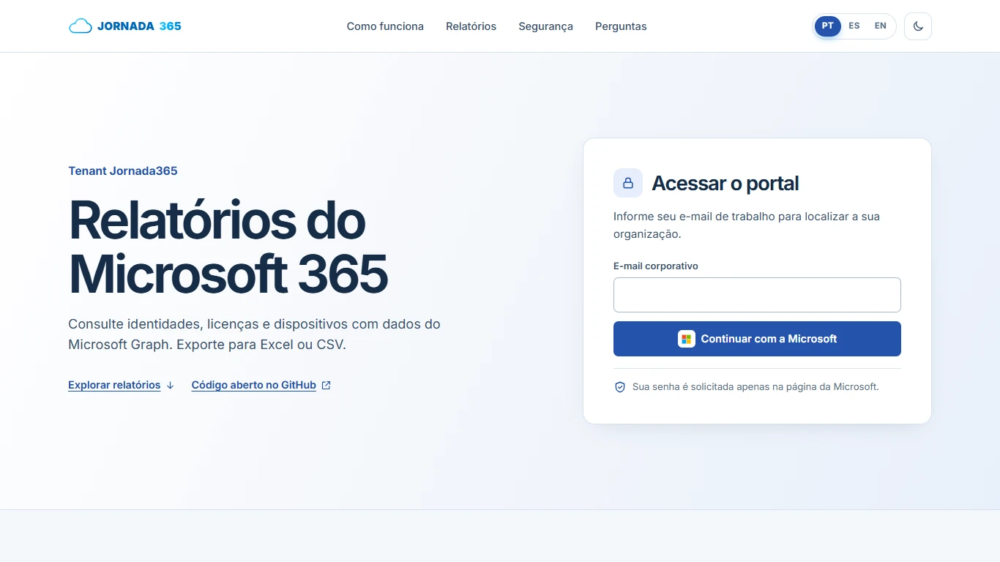
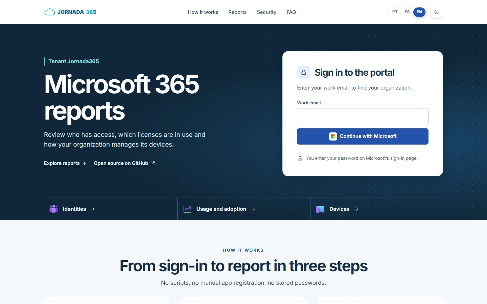

# Configure o login corporativo

Uma empresa pode instalar o Tenant Jornada365 no próprio WordPress e usar seu diretório Microsoft Entra. O login corporativo é opcional. A configuração padrão continua usando o e-mail para localizar o tenant de cada organização.

Na página pública, informe o e-mail corporativo e selecione **Continuar com a Microsoft**. Se a empresa fixou um diretório em **Login corporativo**, basta selecionar o botão configurado pela empresa. Quando o diretório ainda precisa ser conectado, a página fornece um link para encaminhar ao administrador.

### Portal sign-in · English

On a shared installation, enter your work email and select **Continue with Microsoft**. A company installation with a configured directory offers a direct sign-in button. If your directory hasn’t been connected yet, the page provides a link you can send to its administrator.

## Logotipo da empresa no portal

O logotipo exibido na barra superior do Microsoft 365 pertence ao **tema da organização**, configurado no centro de administração do Microsoft 365. A marca da **página de entrada do Entra** tem configuração própria e é a fonte que o portal consulta. Se a imagem existir somente no tema do Microsoft 365, configure-a também no Entra ou envie uma alternativa nas configurações deste portal. [Tema da organização no Microsoft 365](https://learn.microsoft.com/pt-br/microsoft-365/admin/setup/customize-your-organization-theme?view=o365-worldwide)

Depois do login, o cabeçalho procura a identidade visual da experiência de entrada do diretório conectado. O portal consulta a marca padrão e, se necessário, a marca do idioma do portal. Aceita o logotipo quadrado, de banner, de cabeçalho ou de tema escuro. Para publicar uma imagem no diretório, abra **Entra ID → Identidade visual da empresa**. A Microsoft recomenda PNG ou JPEG de 240 × 240 pixels para a imagem quadrada. [Configurar a identidade visual no Microsoft Entra](https://learn.microsoft.com/pt-br/entra/fundamentals/how-to-customize-branding)

No portal, abra **Configurações → Logotipo da organização** para identificar a origem da imagem. Se aparecerem as iniciais, a tela informa quando a marca está ausente, o Graph negou acesso, o arquivo é incompatível ou houve indisponibilidade. Depois de corrigir a marca, selecione **Verificar logotipo**. A leitura ocorre em segundo plano. A aba pode reutilizar a imagem do Entra durante 15 minutos. [Consultar a marca e suas localizações no Microsoft Graph](https://learn.microsoft.com/pt-br/graph/api/organizationalbranding-get?view=graph-rest-1.0)

Para oferecer uma alternativa aos leitores, um **Administrador de identidade visual da organização** (*Organizational Branding Administrator*) ou **Administrador Global** com acesso ao portal pode escolher um PNG ou JPEG de até 64 KiB e 512 × 512 pixels nessa tela e clicar em **Salvar imagem alternativa**. A alternativa fica no WordPress, vinculada exclusivamente ao tenant da sessão e disponível aos usuários autenticados desse tenant. **Remover imagem alternativa** exclui essa configuração. Quando o Graph fornece o logotipo, ele tem prioridade.

No modo delegado, o Graph documenta `User.Read` e uma função compatível, como Leitor Global. No modo clássico, o aplicativo precisa de uma permissão de leitura compatível, como `OrganizationalBranding.Read.All`. O portal usa a autorização existente. A configuração da imagem alternativa dispensa a concessão de acesso adicional à marca do Entra. [Permissões de leitura da marca localizada](https://learn.microsoft.com/pt-br/graph/api/organizationalbrandinglocalization-get?view=graph-rest-1.0)

### Organization logo · English

The portal reads your directory’s **Microsoft Entra sign-in branding**. The logo displayed in the **Microsoft 365 navigation bar** belongs to a separately configured organization theme. If you only set a logo in the Microsoft 365 admin center, add it to Entra sign-in branding or upload a fallback in the portal. [Microsoft 365 organization themes](https://learn.microsoft.com/en-us/microsoft-365/admin/setup/customize-your-organization-theme?view=o365-worldwide) · [Entra company branding](https://learn.microsoft.com/en-us/entra/fundamentals/how-to-customize-branding)

Open **Settings → Organization logo** to see the image source, understand a failed lookup, or select **Check logo** after updating your branding. A signed-in Global Administrator or Organizational Branding Administrator with portal access can upload or remove a PNG or JPEG fallback of up to 64 KiB and 512 × 512 pixels. The fallback is available only to this tenant. When Entra returns a supported logo, it takes precedence.

## Configuração do login

1. No painel do WordPress, abra **Tenant Jornada365 → Configurações**. Selecione a **Página do portal** do próprio site e confirme que ela abre por HTTPS.
2. Em **Login corporativo**, informe o **ID do diretório (tenant)** da empresa, disponível na visão geral do Microsoft Entra ID. Se quiser, ajuste o **Texto do botão** para identificar o login da empresa. [Onde encontrar o ID do tenant no Microsoft Entra](https://learn.microsoft.com/pt-br/entra/fundamentals/how-to-find-tenant)
3. Salve e abra o **Link de conexão** exibido em **Configurações**. Conecte o diretório com uma conta autorizada pelo assistente. O fluxo aceita o aplicativo de página única criado pelo assistente ou um aplicativo já registrado nesse mesmo diretório, configurado com as permissões delegadas e o **Retorno do login (SPA)** exibido pelo plugin. Use exatamente aquele endereço no registro do aplicativo. [Fluxo OAuth da Microsoft com PKCE](https://learn.microsoft.com/pt-br/entra/identity-platform/v2-oauth2-auth-code-flow)
4. Divulgue o **Link para o login corporativo** na intranet. Ele abre a entrada para o diretório configurado e dispensa a pesquisa de tenant por e-mail. As funções do Entra e as permissões delegadas dos módulos continuam aplicadas.
5. Valide em homologação com uma conta que tenha uma função autorizada no diretório e com uma conta de outro diretório. A política é aplicada ao ID do tenant verificado na autenticação, às sessões existentes e às etapas de conexão do tenant. [Claims do ID token no Microsoft Entra](https://learn.microsoft.com/pt-br/entra/identity-platform/id-token-claims-reference)

Para voltar ao login por e-mail, remova o ID em **Login corporativo** e salve. A lista **Restringir a tenants**, quando preenchida, volta a reger o acesso. Registros dos tenants mantêm suas configurações ao alternar o modo.
