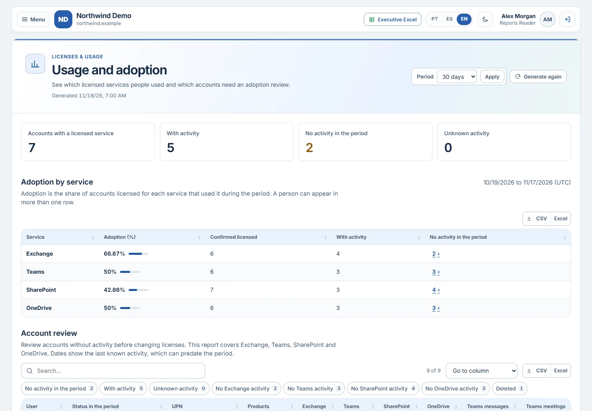
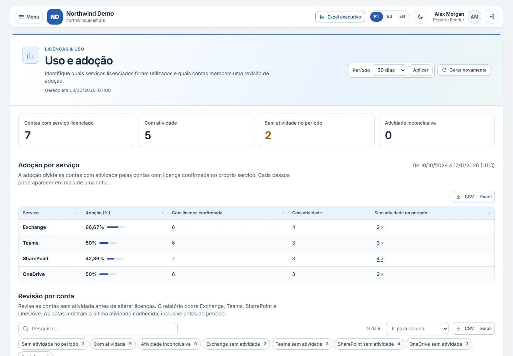

# Usage and adoption

Select a 7, 30, 90 or 180-day period. The first and last days are inclusive and use the Microsoft report refresh date in UTC. Microsoft can return a last activity date earlier than the selected period. [How Microsoft measures usage](https://learn.microsoft.com/en-us/microsoft-365/admin/activity-reports/activity-reports)

| Measure | Interpretation |
| --- | --- |
| Service adoption | Active accounts divided by accounts with a confirmed license for that service. Deleted accounts and accounts with unknown deletion status are excluded. A person can use more than one service. |
| With activity | Distinct accounts that used at least one of their licensed services during the period. |
| No activity in the period | Accounts licensed for at least one of the four services, with no recorded activity in any licensed service during the period. Select the card or a service's inactive count to review the accounts. Activity in other products is outside the report. |
| Unknown activity | The report cannot determine activity in the period for a confirmed licensed account. A service rate is blank if the denominator is zero or activity is inconclusive for a confirmed license. Expand **Partial data coverage** for the missing fields by service. |

The account review includes the last known service dates. Teams messages, meetings and calls come from a second report with its own refresh date. Empty cells mean that the metric was unavailable. Zero means that Microsoft reported zero. The executive Excel workbook includes both the service comparison and the account detail, including per-service status and coverage. [Active user detail](https://learn.microsoft.com/en-us/graph/api/reportroot-getoffice365activeuserdetail?view=graph-rest-1.0) · [Teams user activity detail](https://learn.microsoft.com/en-us/graph/api/reportroot-getteamsuseractivityuserdetail?view=graph-rest-1.0)

## Uso e adoção

Selecione 7, 30, 90 ou 180 dias. O primeiro e o último dia estão incluídos e usam como referência a data de atualização do relatório da Microsoft em UTC. A última atividade informada pode ser anterior ao período selecionado. [Como a Microsoft mede o uso](https://learn.microsoft.com/pt-br/microsoft-365/admin/activity-reports/activity-reports)

| Indicador | Interpretação |
| --- | --- |
| Adoção por serviço | Contas com atividade divididas pelas contas com licença confirmada para o próprio serviço. Contas excluídas ou sem situação de exclusão informada ficam fora do cálculo. Cada pessoa pode utilizar vários serviços. |
| Com atividade | Contas distintas com uso registrado em pelo menos um de seus serviços licenciados na janela selecionada. |
| Sem atividade no período | Contas com licença em pelo menos um dos quatro serviços, sem uso registrado em nenhum dos serviços licenciados na janela. Selecione o indicador ou o número de contas sem atividade de um serviço para revisá-las. O uso de outros produtos fica fora do relatório. |
| Atividade inconclusiva | O relatório não consegue determinar a atividade no período para uma conta com licença confirmada. O percentual do serviço fica em branco quando o denominador é zero ou a atividade é inconclusiva para alguma licença confirmada. Abra **Cobertura parcial dos dados** para consultar os campos ausentes. |

A revisão por conta apresenta as últimas datas conhecidas de atividade em cada serviço. Mensagens, reuniões e chamadas do Teams vêm de um segundo relatório com data de atualização própria. Um campo vazio indica métrica indisponível. Zero indica que a Microsoft informou zero. O Excel executivo inclui a comparação entre serviços e a revisão por conta, com a situação por serviço e a cobertura dos dados. [Detalhes de usuários ativos](https://learn.microsoft.com/pt-br/graph/api/reportroot-getoffice365activeuserdetail?view=graph-rest-1.0) · [Detalhes de atividade do Teams](https://learn.microsoft.com/pt-br/graph/api/reportroot-getteamsuseractivityuserdetail?view=graph-rest-1.0)
